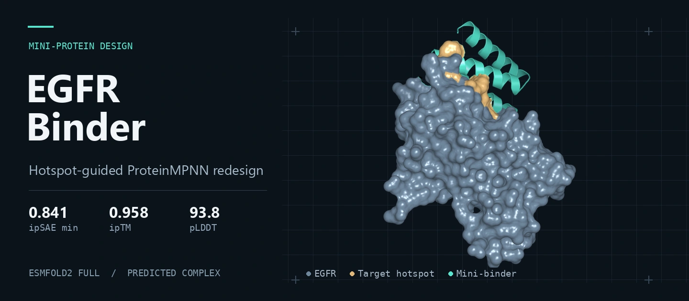

# ESMFold2 Mini-Protein Binder Design



**Scaffold-based mini-protein design with optional target hotspots.** The pipeline
places a scaffold against a supplied target structure, generates ProteinMPNN
sequences, and uses active learning to decide which candidates to co-fold.

The image shows final ProteinMPNN redesign `mpnn_017f451e25bd` from the EGFR
hotspot benchmark (campaign 004, Full-model seed 45). Chain A is EGFR domain
III and chain B is the designed binder. [Predicted PDB](examples/egfr/mpnn_017f451e25bd.pdb) ·
[PAE matrix](examples/egfr/mpnn_017f451e25bd_pae.npy)

## Workflow

1. **Place scaffolds.** Sample rigid-body poses from 243 bundled scaffold
   files. Hotspot mode focuses placement and checks contacts at a specified
   target patch.
2. **Propose and screen.** ProteinMPNN and point mutations generate candidate
   pools. A surrogate trained on ESMC-6B embeddings ranks proposals for
   ESMFold2-Fast screening. Each iteration embeds up to 200 candidates.
3. **Redesign and confirm.** Apply a final ProteinMPNN redesign and rescore
   the shortlist with ESMFold2-Full. The default uses one final seed. Fast
   and Full share a resident ESMC backbone within a campaign process.

| Preset | Placement |
| --- | --- |
| [`binder.yaml`](config/binder.yaml) | Target surface |
| [`binder_hotspot.yaml`](config/binder_hotspot.yaml) | Designated hotspot |

## Benchmark

The archived August 2026 benchmark used 20 attempts per target and
condition, up to five active-learning iterations, and one Full-model
confirmation seed. Counts are unique sequences within each condition that
passed the benchmark filters.

| Target | No hotspot | With hotspot |
| --- | ---: | ---: |
| EGFR domain III | 57 | 93 |
| PD-L1 | 76 | 72 |
| IL-2 | 49 | 121 |

The 120 attempts yielded 468 qualified candidates summed across conditions,
with 5.83 hours of accounted runtime on one GPU.

## Quick start

Run from the repository root with Python 3.12, Git, and a CUDA-enabled
PyTorch environment. The benchmark used one NVIDIA RTX PRO 6000.
Allow about 27 GB on disk for the external model checkpoints.

```bash
python3.12 -m venv .venv
source .venv/bin/activate
python -m pip install --upgrade pip
python -m pip install -r requirements.txt

hf download biohub/ESMFold2 --revision 8fc3ff471022fdce52c77030685eb775de0c00a3 \
  --include 'config.json' 'model.safetensors' 'ccd.pkl' --local-dir models/full
hf download biohub/ESMFold2-Fast --revision c6c7958d63f5f2f1f0fed0bb9462316f8ccceea6 \
  --include 'config.json' 'model.safetensors' --local-dir models/fast
hf download biohub/ESMC-6B --revision 45b0fa5d7fb06faefbd5e3b89bdcef35d564e79a \
  --include '*.json' '*.safetensors' --local-dir models/esmc-6b

python campaign.py --config config/binder_hotspot.yaml --trajectories 20 --min-candidates 3 \
  models.esmfold2.model_path=models/full \
  models.esmfold2.fast_model_path=models/fast \
  models.esmfold2.ccd_cache=models/full \
  models.esmfold2.esmc_path=models/esmc-6b \
  models.esm_engine.model_path=models/esmc-6b
```

The example config uses EGFR domain III. For a custom target, set
`paths.target_fasta` and `paths.target_cif_path` to a matching single-record
FASTA and target-only PDB or mmCIF with chain A. Hotspot positions are
one-based target sequence indices. Set `hotspot.binding_region` in a hotspot
config to a quoted list of positions and ranges, such as `'19,42-44,47'`.

Use `run.py` for one trajectory. Use `campaign.py --resume` to continue an
existing campaign with the same input and model settings. See
[Third-party notices](THIRD_PARTY.md) for the bundled runtime.

## Outputs and scoring

- `runs/campaign_###/` contains the resolved config, status, elapsed time,
  predictions, and final redesigns in `final_post_processed_candidates.csv`.
- `runs/master_candidates.csv` deduplicates and ranks qualified Full-model
  designs. `runs/campaign_summary.json` reports timing and status counts.

The ranking score is `0.5 × ipSAE_min + 0.3 × ipTM + 0.2 × design_pLDDT`,
with pLDDT on a 0–1 scale. `ipSAE_min` takes the lower directional Dunbrack
d0res score at a 10 Å PAE cutoff. The example is a computational prediction
with no experimental validation.

```bash
python scripts/calculate_ipsae.py examples/egfr/mpnn_017f451e25bd_pae.npy examples/egfr/mpnn_017f451e25bd.pdb
python -m unittest discover -s tests -v
```

## References

- [Biohub ESMFold2 and ESMC](https://github.com/Biohub/esm)
- [Dunbrack Lab ipSAE](https://github.com/DunbrackLab/IPSAE)
- [ProteinMPNN](https://github.com/dauparas/ProteinMPNN)
- [Companion VHH and antibody design release](https://github.com/Bio-bbhe/vhh-design-esmfold2)
